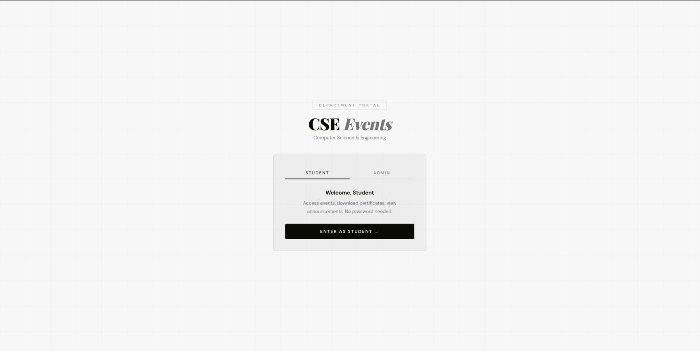
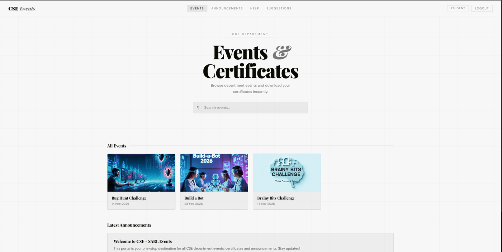
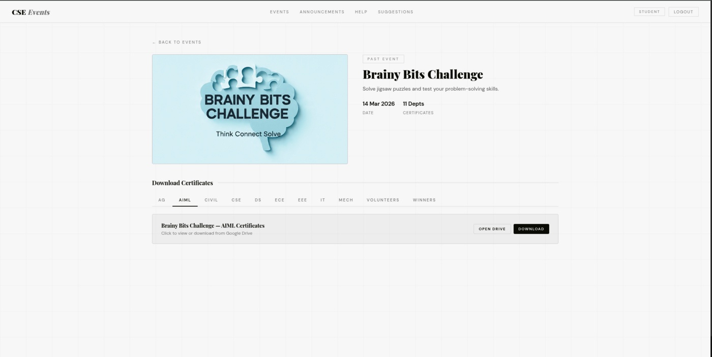
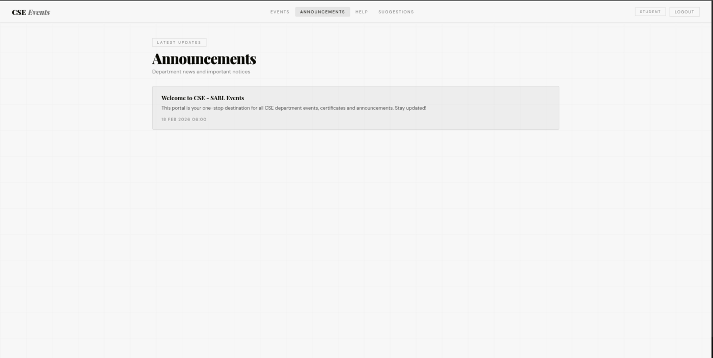
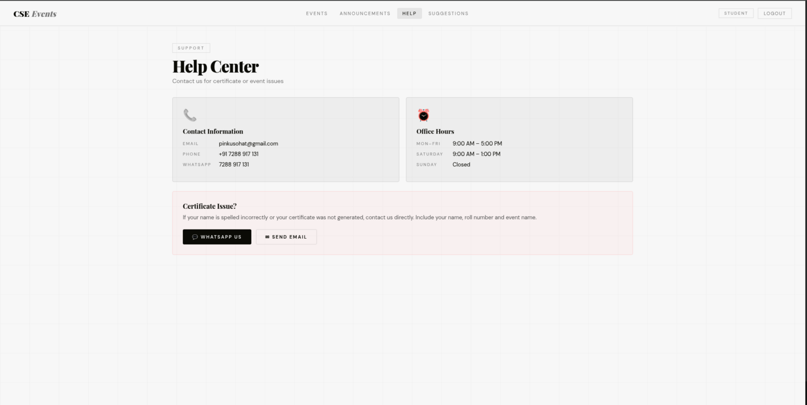

# CSE Events Portal

> A department portal where CSE students browse events, download certificates, and read announcements, with an admin panel for managing it all.

**Live demo:** https://24b11cs433vivek.github.io/CSE-SABL-/
Students can enter without a password. The admin panel is restricted to administrators.

## Screenshots

| Home | Events |
|------|--------|
|  |  |

| Certificates | Announcements | Help Center |
|--------------|---------------|-------------|
|  |  |  |

## Features

**Student view**
- Password-free student access
- Browse department events, with photos and upcoming-event highlights
- Download certificates through department-wise links
- Read the latest announcements
- Help Center with contact details for certificate or event issues
- Suggestion form where the name is optional

**Admin panel**
- Dashboard with counts of events, announcements, and suggestions
- Add, edit, and delete events, with optional photo upload
- Manage department-wise certificate links (Google Drive)
- Post, edit, and delete announcements
- Review and delete student suggestions
- Update the department email, phone, and WhatsApp contact info
- Preview the student view

## Tech Stack

- HTML, CSS, and JavaScript (no build step)
- Hosted on GitHub Pages

## Run Locally

```bash
git clone https://github.com/24B11CS433vivek/CSE-SABL-.git
cd CSE-SABL-
python3 -m http.server 8000
# open http://localhost:8000
```

## Project Structure

```
index.html   # Main page
src/         # Scripts and styles
docs/        # README screenshots
```
